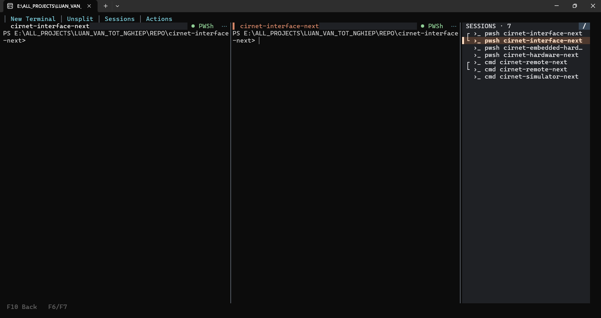

# CIRNETLAB CLI


[](LICENSE)

**CIRNETLAB CLI (`cnl`)** is a Rust tool for managing Git repositories, preparing the environment, building and running the CIRNETLAB system on Windows x64.

<p align="center">
  
</p>

<details>
<summary>View Repository Manager</summary>

<p align="center">
  
</p>
</details>

<details>
<summary>View Terminal</summary>

<p align="center">
  
</p>
</details>

## 1. Install Tools

| Tool | Requirements |
| --- | --- |
| [Git](https://git-scm.com/downloads/win) | Clone and manage source code |
| [Rust & Cargo](https://rustup.rs/) | **1.99.1**, as specified in `rust-toolchain.toml` |
| [PowerShell](https://learn.microsoft.com/powershell/scripting/install/installing-powershell-on-windows) | **7.4+** (`pwsh`) |
| [Visual Studio 2022](https://visualstudio.microsoft.com/vs/older-downloads/) | **Desktop development with C++**, MSVC x64 and Windows SDK |
| [CMake](https://cmake.org/download/) | Build C++ Simulator |
| [Node.js](https://nodejs.org/en/download) | **26.x**, including npm |

`cnl` **does not automatically install** the system toolchain. Cargo and npm automatically download the required dependencies during the build process. **Python `venv` is not required to run the Browser Interface**; Python is only used for certain specialized tests.

## 2. Open the CNL Command Line Interface

- In the `cirnet-cli` directory, enter the following commands:

```powershell
# Build CNL command
cargo build --release
# Run CNL command
cargo run --release
```

## 3. Prepare the Source Code

Place **7 repositories at the same directory level** within a workspace directory.

```powershell
$workspace = "C:\CIRNETLAB"
New-Item -ItemType Directory -Force $workspace | Out-Null
Set-Location $workspace

$repos = @(
  "cirnet-cli", "cirnet-contracts-next", "cirnet-simulator-next",
  "cirnet-hardware-next", "cirnet-remote-next",
  "cirnet-interface-next", "cirnet-embedded-hardware"
)
foreach ($repo in $repos) {
  git clone "https://github.com/cirnetlab/$repo.git"
}
Set-Location .\cirnet-cli
```

GitHub access permissions are required for private repositories. If all 7 local directories already exist, skip the cloning step and open the `cirnet-cli` directory directly.

## 4. Build and Open the Browser Interface

From the `cirnet-cli` directory:

```powershell
# Check the toolchain
cnl doctor
# Verify the environment
cnl setup
# Build the program
cnl build --all
# Open the Browser Interface
cnl run --desktop interface --initialize-db
```

- `cargo install` installs `cnl.exe` (by default in `%USERPROFILE%\.cargo\bin`). If the `cnl` command is not yet recognized, reopen the terminal and check `PATH`.
- `cnl doctor` checks the toolchain; `cnl setup` verifies the environment.
- `cnl build --all` builds and packages the native candidate, storing artifacts **outside the Git checkout**.
- `--initialize-db` is only for the **initial SQLite creation** in a new profile. For subsequent runs, use `cnl run --desktop interface`.

| Mode | Command | Default URL |
| --- | --- | --- |
| Development (Vite, hot reload) | `cnl run --desktop interface` | http://127.0.0.1:5173 |
| Packaged (Rust Remote serves the built web interface) | `cnl run --desktop interface --mode packaged` | http://127.0.0.1:8000 |

The Vue/TypeScript interface belongs to `cirnet-interface-next`; the Rust REST/WebSocket backend belongs to `cirnet-remote-next`. Use `cnl stop` before switching modes within the same profile.

## 5. Common Commands

| Command | Function |
| --- | --- |
| `cargo build --release` | Build the program |
| `cargo run --release` | Run the program |
| `cnl build --all` | Build and package the native candidate |
| `cnl run --desktop interface` | Run the Browser interface |
| `cnl tui --lang vi` | Open the TUI in Vietnamese |
| `cnl repos` | Open the Multi-Repository Manager |
| `cnl status` | Check services |
| `cnl stop` | Stop the CLI-managed runtime session |
| `cnl verify` | Verify the native candidate |
| `cnl setup --browser` | Install Chromium for Playwright (optional) |

**Documentation:** [Vietnamese guide](docs/vi/index.md) · [English guide](docs/en/index.md) · [Command reference VI](docs/vi/commands.md) · [Command reference EN](docs/en/commands.md)
