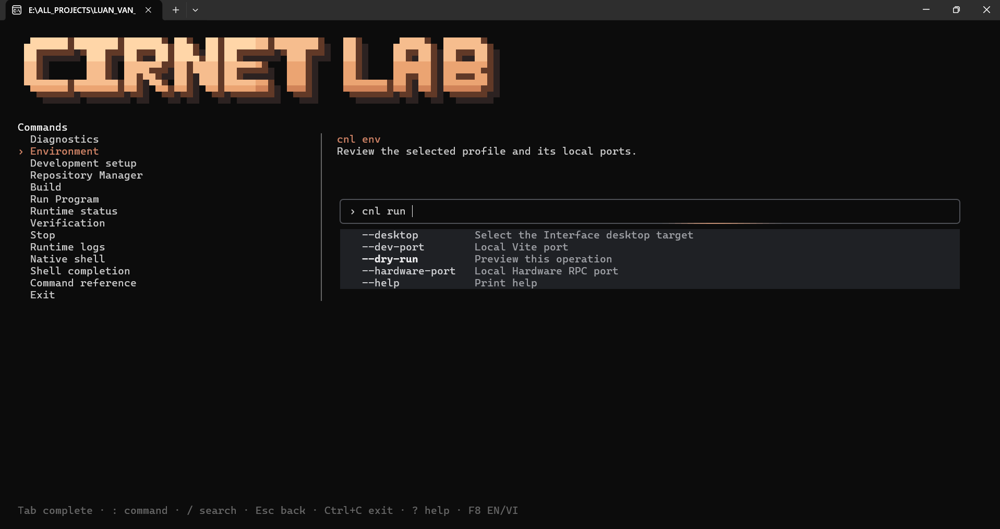

# CIRNETLAB CLI

**CIRNETLAB CLI (`cnl`)** is a command-line tool developed in Rust that supports repository management, development environment setup, compilation, testing, and operation of the CIRNETLAB system.

  

  

**Documentation:** [English](docs/en/index.md) | [Tiếng Việt](docs/vi/index.md)

**Command Reference:** [English](docs/en/commands.md) | [Tiếng Việt](docs/vi/commands.md)

---

## 1. System Requirements

| Công cụ | Phiên bản yêu cầu | Mục đích |
|---|---|---|
| Rust | 1.99.1 | Ngôn ngữ lập trình chính |
| Cargo | Theo Rust 1.99.1 | Build và quản lý dependencies |
| PowerShell | 7.4 trở lên | Thực thi lệnh và tự động hóa |
| CMake | Phiên bản tương thích | Build các thành phần C/C++ |
| Node.js | 26.x | Môi trường thực thi frontend |
| npm | Đi kèm Node.js | Quản lý frontend dependencies |
| Git | Phiên bản tương thích | Quản lý source code |