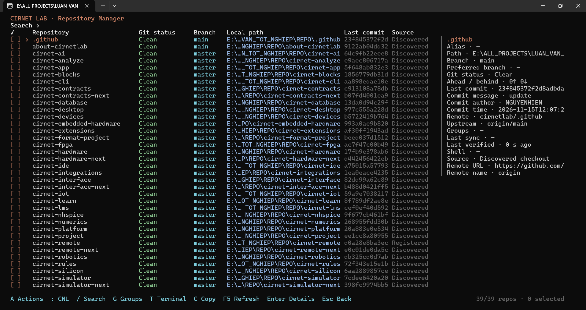

# CIRNETLAB CLI


[](LICENSE)


**CIRNETLAB CLI (`cnl`)** là công cụ Rust để quản lý Git repository, chuẩn bị môi trường, build và chạy hệ thống CIRNETLAB trên Windows x64.

<p align="center">
  
</p>

<details>
<summary>View Repository Manager</summary>

<p align="center">
  
</p>
</details>

<details>
<summary>View Terminal</summary>

<p align="center">
  
</p>
</details>

## 1. Cài đặt công cụ

**Hệ điều hành:** Windows x64. Cài các công cụ sau và bảo đảm gọi được từ PowerShell:

| Công cụ | Yêu cầu |
| --- | --- |
| [Git](https://git-scm.com/downloads/win) | Clone và quản lý source |
| [Rust & Cargo](https://rustup.rs/) | **1.99.1**, theo `rust-toolchain.toml` |
| [PowerShell](https://learn.microsoft.com/powershell/scripting/install/installing-powershell-on-windows) | **7.4+** (`pwsh`) |
| [Visual Studio 2022](https://visualstudio.microsoft.com/vs/older-downloads/) | **Desktop development with C++**, MSVC x64 và Windows SDK |
| [CMake](https://cmake.org/download/) | Build C++ Simulator |
| [Node.js](https://nodejs.org/en/download) | **26.x**, gồm npm |

`cnl` **không tự cài** toolchain hệ thống. Cargo và npm tự tải dependencies cần thiết trong quá trình build. **Không cần Python `venv` để chạy Browser Interface**; Python chỉ phục vụ một số kiểm thử chuyên biệt.

## 2. Chuẩn bị mã nguồn

Đặt **7 repository cùng cấp** trong một thư mục workspace. Ví dụ mở PowerShell 7 và chạy:

```powershell
$workspace = "C:\CIRNETLAB"
New-Item -ItemType Directory -Force $workspace | Out-Null
Set-Location $workspace

$repos = @(
  "cirnet-cli", "cirnet-contracts-next", "cirnet-simulator-next",
  "cirnet-hardware-next", "cirnet-remote-next",
  "cirnet-interface-next", "cirnet-embedded-hardware"
)
foreach ($repo in $repos) {
  git clone "https://github.com/cirnetlab/$repo.git"
}
Set-Location .\cirnet-cli
```

Cần có quyền GitHub đối với repository riêng tư. Nếu đã có đủ 7 thư mục local, bỏ qua bước clone và mở trực tiếp thư mục `cirnet-cli`.

## 3. Build và mở Browser Interface

Từ thư mục `cirnet-cli`:

```powershell
cargo install --locked --path .
cnl doctor
cnl setup
cnl build --all
cnl run --desktop interface --initialize-db
```

- `cargo install` cài `cnl.exe` (mặc định trong `%USERPROFILE%\.cargo\bin`). Nếu chưa nhận lệnh `cnl`, mở lại terminal và kiểm tra `PATH`.
- `cnl doctor` kiểm tra toolchain; `cnl setup` xác nhận môi trường.
- `cnl build --all` build và đóng gói native candidate, lưu artifacts **ngoài Git checkout**.
- `--initialize-db` chỉ dành cho **lần tạo SQLite đầu tiên** trong profile mới. Các lần sau dùng `cnl run --desktop interface`.

| Chế độ | Lệnh | URL mặc định |
| --- | --- | --- |
| Development (Vite, hot reload) | `cnl run --desktop interface` | http://127.0.0.1:5173 |
| Packaged (Rust Remote phục vụ web đã build) | `cnl run --desktop interface --mode packaged` | http://127.0.0.1:8000 |

Giao diện Vue/TypeScript thuộc `cirnet-interface-next`; backend Rust REST/WebSocket thuộc `cirnet-remote-next`. Dùng `cnl stop` trước khi đổi chế độ trong cùng profile.

## 4. Lệnh thường dùng

| Lệnh | Chức năng |
| --- | --- |
| `cnl tui --lang vi` | Mở TUI bằng tiếng Việt |
| `cnl repos` | Mở Multi-Repository Manager |
| `cnl status` | Kiểm tra các dịch vụ |
| `cnl stop` | Dừng phiên runtime do CLI quản lý |
| `cnl verify` | Kiểm chứng native candidate |
| `cnl setup --browser` | Cài Chromium phục vụ Playwright (tùy chọn) |

Khi chạy `cnl` ngoài workspace, chỉ định `--workspace <DIRECTORY>` hoặc biến môi trường `CNL_WORKSPACE`. Giữ cùng workspace và profile giữa các bước build/run.

**Tài liệu:** [Hướng dẫn tiếng Việt](docs/vi/index.md) · [English guide](docs/en/index.md) · [Tham chiếu lệnh VI](docs/vi/commands.md) · [Command reference EN](docs/en/commands.md)
